<p align="center">
  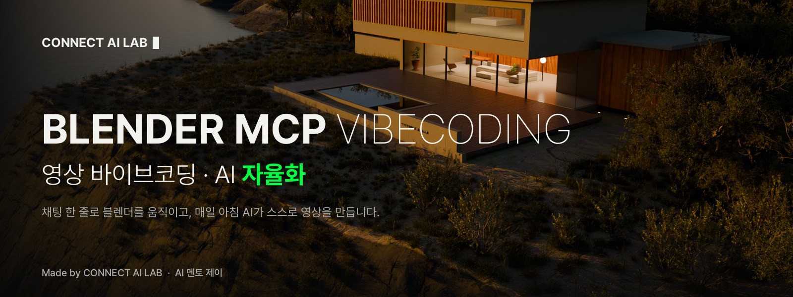
</p>

<p align="center">
  <a href="LICENSE"></a>
  
  <a href="https://www.youtube.com/@CONNECT-AI-LAB"></a>
</p>

<table>
  <tr>
    <td width="33%"><a href="tutorials/00_golden-hour-villa/">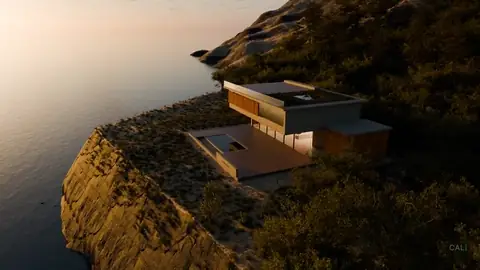</a></td>
    <td width="33%"><a href="tutorials/01_seoul-day-night-rain/">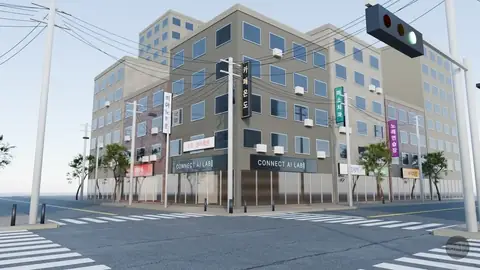</a></td>
    <td width="33%"><a href="tutorials/02_rainy-night-laundromat/">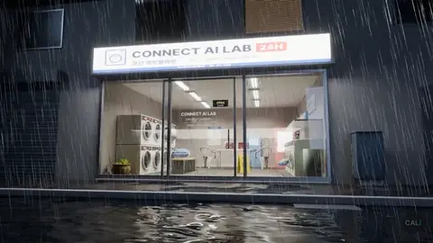</a></td>
  </tr>
  <tr>
    <td width="33%"><a href="tutorials/03_studio-apartment-interior/">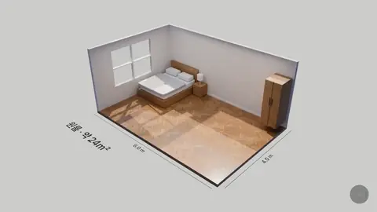</a></td>
    <td width="33%"><a href="tutorials/04_channel-logo-intro/">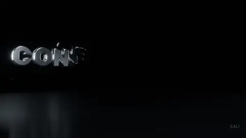</a></td>
    <td width="33%"><a href="tutorials/05_audio-reactive-loop/">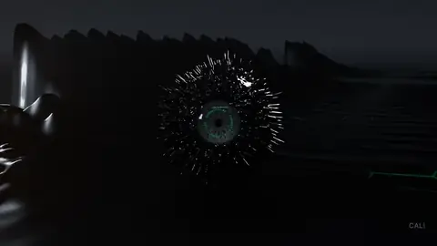</a></td>
  </tr>
</table>

<a href="https://www.youtube.com/@CONNECT-AI-LAB">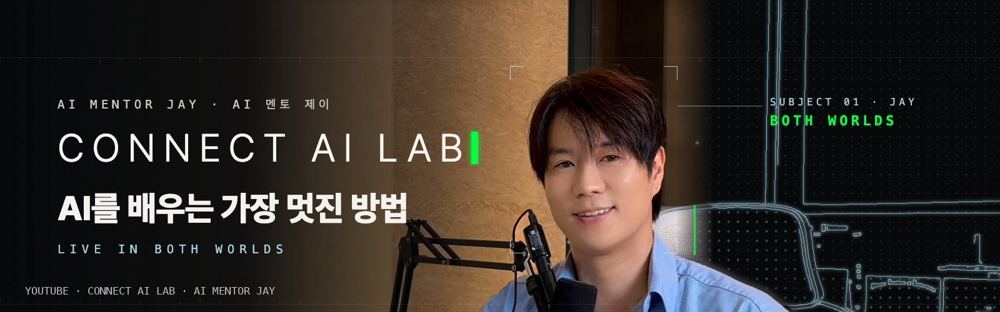</a>

이 레포를 만드는 과정과 튜토리얼 영상은 유튜브에서: [youtube.com/@CONNECT-AI-LAB](https://www.youtube.com/@CONNECT-AI-LAB)

## 코딩으로 만든다 · Built with code

AI는 블렌더를 마우스로 만지지 않아요. 블렌더 파이썬(bpy) 코드를 써서 실행하고, 화면을 보고, 코드를 고쳐요.
그래서 같은 코드면 같은 장면이 다시 나오고, 한 줄만 바꿔도 장면 전체가 바뀌고, 생성 서비스 비용이 들지 않아요.
각 튜토리얼의 `scripts/`에 AI가 실제로 쓴 코드가 들어 있어요. 아래는 노을 빌라의 하늘을 만든 코드의 일부예요.

```python
# tutorials/00_golden-hour-villa/scripts/villa_sky.py (발췌)
sky = nt.nodes.new("ShaderNodeTexSky"); sky.sky_type = 'MULTIPLE_SCATTERING'
EL = math.radians(S.get("sun_el", 7.0)); AZ = math.radians(S.get("sun_az", 203.0))
sky.sun_elevation = EL   # 태양 높이: 4~5도면 골든아워, 0도 아래로 내리면 블루아워와 밤
sky.sun_rotation = (math.pi/2 - AZ) % (2*math.pi)
```

## 영상 바이브코딩 · AI 자율화

블렌더 MCP를 연결하면 Claude Code, Antigravity, Codex, Cursor 같은 AI가 채팅만으로 블렌더를 움직입니다. 모델링, 재질, 조명, 카메라, 렌더까지요.
여기에는 AI와 채팅으로 만든 3D 세계 6개와, 그 안에서 실습할 프롬프트가 들어 있어요.
3D 세계를 한 번 만들어 두면, 매일 정해진 시간에 AI가 그 안에서 스스로 영상을 만듭니다.

## 시작은 3단계

Mac · Windows · Linux 모두 됩니다. 블렌더 3.0 이상이면 MCP가 동작하고, 이 레포의 장면 파일은 블렌더 5.2 이상에서 열어 주세요.

```bash
# 01  블렌더 설치 (무료): https://www.blender.org/download/

# 02  uv 설치 → 한 줄 설정
brew install uv                         # Mac
winget install --id=astral-sh.uv -e     # Windows
uvx mcp-for-blender setup               # 공통: AI 앱 등록 + 블렌더 애드온 설치 · 켜기

# 03  AI 앱을 완전히 껐다 켜고, 블렌더는 켜 둔 채로
#     블렌더 3D 화면에서 N 키 → MCP for Blender 탭 → "Connected on port 9876"
```

`uvx mcp-for-blender setup`은 설치된 AI 앱(Claude Desktop, Claude Code, Codex, Cursor, VS Code, Devin Desktop/Windsurf, OpenCode, Antigravity)을 찾아 블렌더 항목만 더하고, 바꾸는 파일마다 `.bak` 백업을 남겨요. 꺼져 있으면 Connect to MCP server 버튼을 누르고, AI 앱에서 [prompts/00_connect-check.txt](prompts/00_connect-check.txt)로 첫 대화를 하세요.

그다음 장면 하나를 받아 열면 끝이에요.

```bash
python tools/get_scene.py --list
python tools/get_scene.py golden-hour-villa
```

## 튜토리얼

| | 장면 | 배우는 것 | 난이도 | 크기 |
|---|---|---|---|---|
| 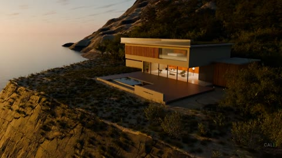 | [00 노을 빌라](tutorials/00_golden-hour-villa/) | 빛 · 날씨 · 카메라만 바꿔 오늘의 장면 만들기, 매일 아침 자동 렌더 | 입문 | 1.05 GB |
| 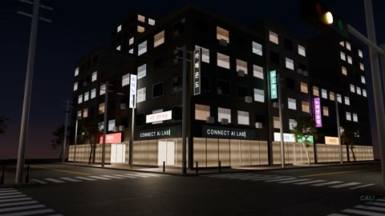 | [01 서울 사거리 · 낮 밤 비](tutorials/01_seoul-day-night-rain/) | 값 하나로 장면 전체를 바꾸는 상태 채널, 새 날씨 추가 | 중급 | 98 MB |
| 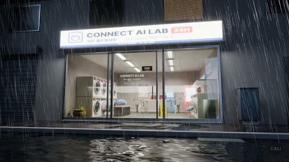 | [02 비 오는 밤의 무인 빨래방](tutorials/02_rainy-night-laundromat/) | 조명 읽기, 시간대 바꾸기, 원테이크 카메라 | 중급 | 83 MB |
| 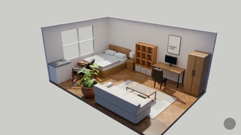 | [03 원룸 인테리어 3D 투어](tutorials/03_studio-apartment-interior/) | 치수 바꾸기, 가구 재배치, 낮 · 밤 버전 | 입문 | 73 MB |
| 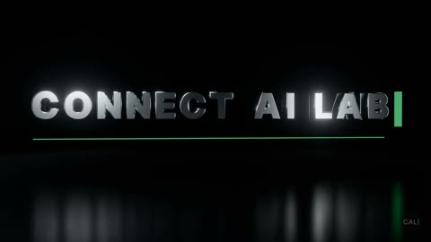 | [04 채널 3D 로고 인트로](tutorials/04_channel-logo-intro/) | 내 채널 이름 · 색으로 바꾸기, 세로 버전 | 입문 | 2 MB |
| 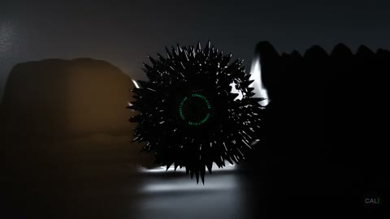 | [05 음악에 반응하는 루프](tutorials/05_audio-reactive-loop/) | 소리 분석값으로 움직이는 장면, 내 곡으로 다시 굽기 | 중급 | 6 MB |

모든 튜토리얼은 같은 흐름이에요. 장면 열기 → 프롬프트 붙여 넣기 → AI가 보고 고치는 걸 지켜보기 → 렌더 → 원본과 비교. 각 폴더의 `prompt.txt`는 그 장면을 처음 만들 때 실제로 쓴 프롬프트예요.

## AI 자율화: 매일 아침 08:00

```bash
bash autopilot/run_daily.sh
```

[autopilot/](autopilot/)의 스크립트가 노을 빌라를 열고, 날짜마다 시간대(골든아워 · 블루아워 · 밤 · 새벽) x 날씨(맑음 · 안개 · 비) x 카메라 구간을 골라 세로 3초 영상을 렌더해요. macOS launchd와 Windows 작업 스케줄러 템플릿이 들어 있어요. 등록은 직접 하세요. 아니면 AI에게 [prompts/03_make-it-daily.txt](prompts/03_make-it-daily.txt)를 주면 돼요.

## 레포 구성

```
prompts/        복사해서 그대로 쓰는 프롬프트 (연결 확인, 보고 고치기, 오늘의 장면, 매일 자동)
tutorials/      장면별 실습: README, 원본 prompt.txt, preview.jpg, scripts/ (AI가 쓴 블렌더 파이썬)
scenes/         manifest.json (파일 이름, 크기, sha256, 라이선스, 크레딧)
tools/          get_scene.py (다운로드 + sha256 확인), render_scene.py (창 없이 렌더)
autopilot/      todays_scene.py, run_daily.sh / .ps1, launchd · 작업 스케줄러 템플릿
```

장면 파일(.blend)은 git에 넣지 않고 [Releases](https://github.com/wonseokjung/blender-mcp-vibecoding/releases)에 올려 두었어요. `get_scene.py`가 받아서 sha256까지 확인해요. 텍스처와 글꼴은 파일 안에 모두 들어 있어요.

## 솔직한 한계

- 복잡한 생명체는 아직 어려워요. 사람 · 동물을 처음부터 만드는 건 서툴러요. 대신 이미 있는 리그 캐릭터를 불러와 움직이는 건 아주 잘해요.
- 렌더는 GPU 시간이 들어요. 미리보기는 몇 초지만, Cycles 최종 렌더는 한 프레임에 수십 초씩 걸릴 수 있어요. 밤새 돌려 두는 걸 추천해요.
- 3D 생성 서비스는 유료일 수 있어요. 이 레포의 장면은 그런 서비스 없이 만들었어요.
- AI가 블렌더 안에서 파이썬을 실행하니, 작업 전에는 파일을 저장해 두세요. 애드온은 내 컴퓨터 안(localhost:9876)에서만 명령을 받아요.

## English

**Blender MCP vibecoding by CONNECT AI LAB.** Connect Blender to an AI app (Claude Code, Antigravity, Codex, Cursor and others) with the open-source `mcp-for-blender` add-on, and drive modelling, materials, lights, cameras and renders by chat. This repo ships six ready-made scenes that were built that way, practice prompts from easy to hard for each, and an autopilot that opens the golden-hour villa every morning, picks a time of day, weather and camera move, and renders a short vertical clip.

1. Install Blender from blender.org (scenes need 5.2 or newer).
2. Install uv (`brew install uv` or `winget install --id=astral-sh.uv -e`), then run `uvx mcp-for-blender setup`.
3. Restart your AI app, keep Blender open, press N in the 3D view, MCP for Blender tab, check "Connected on port 9876".

Then `python tools/get_scene.py golden-hour-villa` and follow [tutorials/00_golden-hour-villa](tutorials/00_golden-hour-villa/). Each tutorial README has an English summary at the end; English prompts are in `prompts/*.en.txt`.

## License · Credits

- Code and prompts: [MIT](LICENSE)
- Scenes: [CC BY 4.0](LICENSE-SCENES.md), credit "Scene: CONNECT AI LAB (AI 멘토 제이)"
- Bundled assets: Poly Haven CC0, Pretendard SIL OFL 1.1, full list in [CREDITS.md](CREDITS.md)
- Cite: [CITATION.cff](CITATION.cff)

---

<a href="https://www.youtube.com/@CONNECT-AI-LAB"></a>

<p align="center">
  <b>Made by CONNECT AI LAB · AI 멘토 제이</b><br>
  <a href="https://www.youtube.com/@CONNECT-AI-LAB">YouTube @CONNECT-AI-LAB</a> · <a href="https://www.aicitybuilders.com">aicitybuilders.com</a>
</p>
