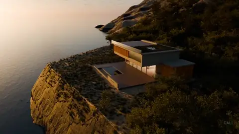
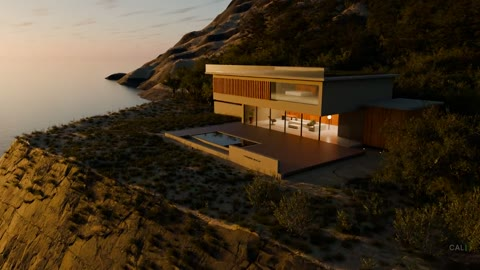

# 00 · 노을 빌라: AI가 매일 아침 만드는 오늘의 장면



바다 절벽 위 빌라와 인피니티 풀, 숲까지 다 만들어진 3D 세계예요. 우리가 할 일은 하나뿐이에요. AI에게 오늘의 빛과 날씨, 카메라를 고르게 하고, 그걸 매일 아침 저절로 돌게 만드는 것.

| 항목 | 값 |
|---|---|
| 모델 | `golden-hour-villa.blend` · 1.05 GB · Blender 5.2 이상 |
| 엔진 | Cycles (GPU 권장) |
| 난이도 | 입문 (장면은 완성돼 있고, 바꾸는 건 빛 · 날씨 · 카메라뿐) |
| 원본 프롬프트 | [prompt.txt](prompt.txt): 이 장면을 처음 만들 때 실제로 쓴 프롬프트 |

## 1. 모델 받기

```bash
python tools/get_scene.py golden-hour-villa
```

`scenes/blend/golden-hour-villa.blend`에 받고 sha256까지 확인해요. 1 GB가 넘으니 시간이 조금 걸려요. 끊기면 같은 명령을 다시 실행하면 이어 받아요.

## 2. 블렌더에서 열고 연결 확인

1. 블렌더로 `golden-hour-villa.blend`를 열어요.
2. 3D 화면에서 N 키 → MCP for Blender 탭 → Connected on port 9876 확인.
3. AI 앱(Claude Code, Antigravity, Codex, Cursor 등)에 [prompts/00_connect-check.txt](../../prompts/00_connect-check.txt)를 붙여 넣어요.

## 3. 오늘의 장면 만들기 (채팅으로)

[prompts/02_todays-scene.txt](../../prompts/02_todays-scene.txt)를 그대로 붙여 넣으세요. 영어는 `02_todays-scene.en.txt`.

AI가 하는 일:

| 순서 | 부르는 도구 | 하는 일 |
|---|---|---|
| 1 | `get_scene_info` | 하늘(Sky Texture), 실내 조명, 드론 카메라를 찾아요 |
| 2 | `execute_blender_code` | 태양 고도 · 방향, 실내 조명 세기, 안개 · 비, 카메라 구간을 바꿔요 |
| 3 | `look` | 카메라 화면을 캡처해서 직접 봐요 |
| 4 | `execute_blender_code` | 어색한 곳을 하나씩 고쳐요 (최소 3번) |
| 5 | `execute_blender_code` | 세로 1080x1920 3초로 렌더해요 |

보고 고치는 반복을 더 길게 시키고 싶으면 [prompts/01_look-compare-fix-loop.txt](../../prompts/01_look-compare-fix-loop.txt)를 끝에 붙이세요.

## 4. 렌더만 따로 돌리기 (창 없이)

```bash
python tools/render_scene.py scenes/blend/golden-hour-villa.blend --frame 144 --percent 50
```

먼저 절반 해상도 한 장으로 시간을 재 보고, 전체 길이를 거세요. GPU 하나에 렌더는 한 번에 하나만.

## 5. 매일 아침 저절로 (AI 자율화)

```bash
bash autopilot/run_daily.sh                      # Mac · Linux, 손으로 한 번 테스트
bash autopilot/run_daily.sh --time night --weather light_rain --shot pool_reveal
```

`autopilot/todays_scene.py`가 날짜를 씨앗으로 시간대 4종 x 날씨 3종 x 카메라 4구간 중 하나를 골라 렌더하고, `out/날짜/`에 프레임, mp4, `params.json`을 남겨요. 등록은 [autopilot/README.md](../../autopilot/README.md)를 보세요. 아니면 AI에게 [prompts/03_make-it-daily.txt](../../prompts/03_make-it-daily.txt)를 주고 맡기면 돼요.

## 6. 내 것으로 만들기

- 표에 새 시간대를 더해 보세요. 예: "TIMES에 '한여름 정오'를 추가해줘. 태양 고도 70도, 그림자 짧게."
- 오늘의 장면을 SNS용으로: "렌더가 끝나면 첫 프레임으로 썸네일 1장, 영상 설명 3줄도 써줘."
- 엔드태그 · 워터마크(선택): `run_daily.sh`는 ffmpeg가 있으면 오른쪽 아래에 `docs/media/cal_watermark.png`를 약 65 % 불투명도로 얹어요. 내 채널 마크로 바꾸려면 `WATERMARK=내마크.png`. 장면 안의 CONNECT AI LAB 글자는 장면의 일부이니 그대로 두세요.

## 비교

| 원본 결과 (13초 드론 원테이크) | 내가 만든 오늘의 장면 |
|---|---|
|  | `out/날짜/todays_scene_날짜.mp4` |

## 스크립트 · scripts/

`scripts/iterations/`는 AI가 이 장면을 만들 때 Blender MCP의 `execute_blender_code`로 실제로 보낸 코드를 순서대로 모은 것이고, `scripts/`의 나머지 파일은 그 코드가 불러 쓴 빌드 스크립트예요. 원래 작업 폴더의 절대 경로는 상대 경로로 바꿔 두었어요. 처음부터 다시 만드는 참고용이라 그대로 실행하면 경로나 순서가 맞지 않을 수 있어요. 완성된 장면은 위의 모델 파일을 쓰세요.

---
English: open the prebuilt villa, paste `prompts/02_todays-scene.en.txt`, let the AI pick light, weather and a camera stretch, render a 3 s vertical clip, then schedule `autopilot/run_daily.sh` for every morning. The `scripts/` folder holds the Blender Python the AI actually wrote for this scene (paths made relative; for reference).
