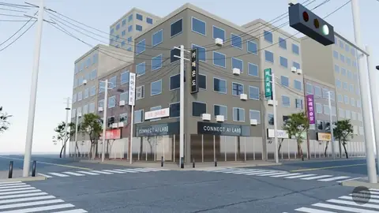
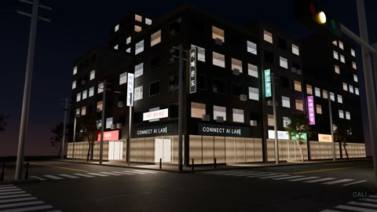

# 01 · 서울 사거리: 낮 → 밤 → 비



간판과 전선이 엉킨 서울 골목 사거리 하나. 해가 지고, 간판이 하나씩 켜지고, 비가 내려요. 모든 빛과 날씨가 `CTRL` 엠프티의 값 다섯 개(`sun`, `night`, `rain`, `wet`, `sig`)에 묶여 있어서, 숫자 하나로 장면 전체가 바뀌어요.

| 모델 | 난이도 | 엔진 | 원본 프롬프트 |
|---|---|---|---|
| `seoul-day-night-rain.blend` · 98 MB | 중급 | Cycles | [prompt.txt](prompt.txt) |

## 받기 · 열기

```bash
python tools/get_scene.py seoul-day-night-rain
```

블렌더로 열고 N 키 → MCP for Blender 탭에서 연결을 확인한 뒤 [prompts/00_connect-check.txt](../../prompts/00_connect-check.txt)로 시작하세요.

## 실습 프롬프트

**쉬움**
```
CTRL 엠프티에 어떤 값이 있고 각각 무엇을 움직이는지 표로 정리해줘. 그다음 100프레임을 카메라로 캡처해서 보여줘.
```

**중간**
```
비 오는 밤 상태로 고정된 5초짜리 세로 영상(1080x1920)을 만들어줘. CTRL의 night, rain, wet 값만 바꾸고, 젖은 도로에 CONNECT AI LAB 간판이 비치는지 look으로 확인하면서 고쳐줘.
```

**어려움**
```
'첫눈 오는 밤'을 새 상태로 추가해줘. CTRL에 snow 값을 만들고 드라이버로 연결해서, 비 대신 천천히 떨어지는 눈송이와 보도 위에 얇게 쌓이는 흰색을 만들어줘. 낮 → 밤 → 눈 순서로 14초 렌더.
```

## 결과 예시



## 내 것으로 만들기

간판은 PIL로 그린 이미지예요. "모퉁이 1층 간판을 내 가게 이름 OOO로 바꿔줘. 같은 서체 느낌, 검정 바탕에 흰 글자" 처럼 내 가게 · 내 채널 이름으로 바꿔 보세요. 실존 상호나 남의 브랜드는 쓰지 마세요.

## 스크립트 · scripts/

`scripts/iterations/`는 AI가 이 장면을 만들 때 Blender MCP의 `execute_blender_code`로 실제로 보낸 코드를 순서대로 모은 것이고, `scripts/`의 나머지 파일은 그 코드가 불러 쓴 빌드 스크립트예요. 원래 작업 폴더의 절대 경로는 상대 경로로 바꿔 두었어요. 처음부터 다시 만드는 참고용이라 그대로 실행하면 경로나 순서가 맞지 않을 수 있어요. 완성된 장면은 위의 모델 파일을 쓰세요.

---
English: a Seoul crossroads whose light and weather are driven by five values on the `CTRL` empty. Practice: read the controls, lock a rainy-night vertical clip, then add a new snow state. The `scripts/` folder holds the Blender Python the AI actually wrote for this scene (paths made relative; for reference).
