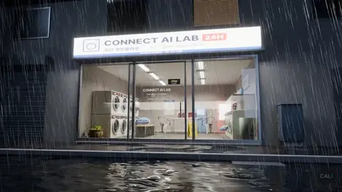
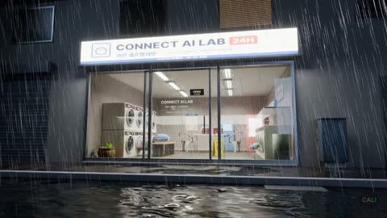

# 02 · 비 오는 밤의 무인 빨래방



깜빡이는 형광등, 비스듬한 비, 돌아가는 건조기. 길 건너편에서 바라보는 포토리얼 야경이에요. 모든 소품은 Poly Haven CC0, 간판 · 포스터 · 스티커는 이 장면을 위해 직접 그린 인쇄물이에요.

| 모델 | 난이도 | 엔진 | 원본 프롬프트 |
|---|---|---|---|
| `rainy-night-laundromat.blend` · 83 MB | 중급 | Cycles | [prompt.txt](prompt.txt) |

## 받기 · 열기

```bash
python tools/get_scene.py rainy-night-laundromat
```

## 실습 프롬프트

**쉬움**
```
지금 장면에서 조명을 전부 찾아 이름, 색온도, 세기를 표로 알려줘. 깜빡이는 형광등이 어느 것인지도 알려줘.
```

**중간**
```
비를 그치게 하고 새벽 5시 느낌으로 바꿔줘. 하늘은 짙은 남색에서 아주 옅게 밝아지고, 실내 형광등은 그대로. 바닥 물웅덩이는 남겨줘. look으로 3번 보고 고친 다음 한 장 렌더해줘.
```

**어려움**
```
카메라를 유리문 안으로 천천히 들어가는 8초 원테이크로 바꿔줘. 문턱에서 빗소리가 줄어드는 느낌이 나게 초점 거리와 심도를 바꾸고, 마지막은 돌아가는 건조기 드럼 클로즈업. 카메라가 벽이나 소품을 뚫지 않는지 확인해줘.
```

## 결과 예시



## 내 것으로 만들기

"간판 글자를 내 브랜드 이름으로 바꿔줘. 3D 글자 말고, 지금처럼 인쇄물 텍스처로" 라고 하면 라이트박스 간판이 내 것이 돼요.

## 스크립트 · scripts/

`scripts/iterations/`는 AI가 이 장면을 만들 때 Blender MCP의 `execute_blender_code`로 실제로 보낸 코드를 순서대로 모은 것이고, `scripts/`의 나머지 파일은 그 코드가 불러 쓴 빌드 스크립트예요. 원래 작업 폴더의 절대 경로는 상대 경로로 바꿔 두었어요. 처음부터 다시 만드는 참고용이라 그대로 실행하면 경로나 순서가 맞지 않을 수 있어요. 완성된 장면은 위의 모델 파일을 쓰세요.

---
English: a photoreal rainy-night laundromat. Practice: list the lights, turn it into a dawn shot, then fly the camera through the glass door. The `scripts/` folder holds the Blender Python the AI actually wrote for this scene (paths made relative; for reference).
