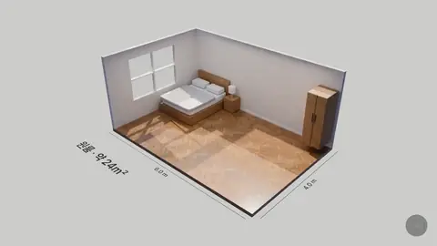
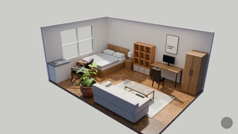

# 03 · 원룸 인테리어 3D 투어



돌하우스처럼 잘린 6 x 4 m 원룸에 가구가 하나씩 떨어져 자리를 잡아요. 가구와 마루, 원단은 Poly Haven의 실제 스캔(CC0)이에요. 인테리어 · 부동산 소개 영상의 기본형.

| 모델 | 난이도 | 엔진 | 원본 프롬프트 |
|---|---|---|---|
| `studio-apartment-interior.blend` · 73 MB | 입문 | Cycles | [prompt.txt](prompt.txt) |

## 받기 · 열기

```bash
python tools/get_scene.py studio-apartment-interior
```

## 실습 프롬프트

**쉬움**
```
치수 라벨을 내 방 크기로 바꿔줘: 가로 5.2 m, 세로 3.6 m, 제목은 '원룸 · 약 19㎡'. 라벨만 바꾸고 방 크기는 그대로 둬.
```

**중간**
```
방 크기를 실제로 5.2 x 3.6 m로 줄이고, 가구가 벽을 뚫지 않게 다시 배치해줘. 위에서 본 화면과 소파 뒤 눈높이 화면을 look으로 확인해줘.
```

**어려움**
```
같은 방을 '밤 버전'으로 하나 더 만들어줘. 창밖은 어두운 도시, 실내는 2700K 스탠드와 간접조명. 낮 투어 7초 뒤에 밤 투어 7초가 이어지는 14초 영상으로 렌더해줘.
```

## 결과 예시



## 내 것으로 만들기

"Poly Haven에서 내 취향 가구로 바꿔줘: 라탄 의자, 큰 몬스테라, 원목 책상. 실제 크기로" 처럼 search_assets / import_asset을 쓰게 하면 돼요.

## 스크립트 · scripts/

`scripts/iterations/`는 AI가 이 장면을 만들 때 Blender MCP의 `execute_blender_code`로 실제로 보낸 코드를 순서대로 모은 것이고, `scripts/`의 나머지 파일은 그 코드가 불러 쓴 빌드 스크립트예요. 원래 작업 폴더의 절대 경로는 상대 경로로 바꿔 두었어요. 처음부터 다시 만드는 참고용이라 그대로 실행하면 경로나 순서가 맞지 않을 수 있어요. 완성된 장면은 위의 모델 파일을 쓰세요.

---
English: a dollhouse cutaway studio apartment with Poly Haven scans. Practice: relabel the size, really resize the room, then add a night version. The `scripts/` folder holds the Blender Python the AI actually wrote for this scene (paths made relative; for reference).
