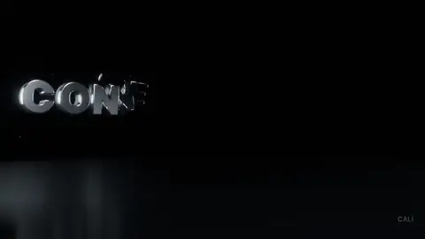

# 04 · 채널 3D 로고 인트로



글자 하나하나가 어둠에서 회전하며 날아와 착지하고, 빛 한 줄기가 표면을 쓸고, 초록 밑줄과 커서가 그어지는 7초 인트로. 가장 작고 가벼운 모델이라 처음 연습하기 좋아요. EEVEE라 렌더도 빨라요.

| 모델 | 난이도 | 엔진 | 원본 프롬프트 |
|---|---|---|---|
| `channel-logo-intro.blend` · 2 MB | 입문 | EEVEE | [prompt.txt](prompt.txt) |

## 받기 · 열기

```bash
python tools/get_scene.py channel-logo-intro
```

## 실습 프롬프트

**쉬움**
```
슬로건 글자를 '매일 한 편, AI와 함께'로 바꾸고 100프레임을 캡처해서 보여줘.
```

**중간**
```
채널 이름 글자를 내 채널 이름 'MY CHANNEL'로 바꿔줘. 지금처럼 글자마다 따로 된 3D 메탈 글자로, 실제 글자 폭을 재서 간격을 고르게 하고, 날아오는 애니메이션 순서도 새 글자 수에 맞춰줘.
```

**어려움**
```
포인트 색을 내 채널 색 #FF5A36 하나로 바꾸고(화면의 10 % 이하), 세로 1080x1920 버전 카메라를 따로 만들어줘. 가로 · 세로 두 개를 렌더해줘.
```

## 결과 예시


## 내 것으로 만들기

글꼴은 Pretendard(SIL OFL)가 파일 안에 들어 있어요. 다른 글꼴을 쓰려면 상업용 무료인지 먼저 확인하세요.

## 스크립트 · scripts/

`scripts/iterations/`는 AI가 이 장면을 만들 때 Blender MCP의 `execute_blender_code`로 실제로 보낸 코드를 순서대로 모은 것이고, `scripts/`의 나머지 파일은 그 코드가 불러 쓴 빌드 스크립트예요. 원래 작업 폴더의 절대 경로는 상대 경로로 바꿔 두었어요. 처음부터 다시 만드는 참고용이라 그대로 실행하면 경로나 순서가 맞지 않을 수 있어요. 완성된 장면은 위의 모델 파일을 쓰세요.

---
English: a 7 s chrome-letter channel intro (EEVEE, 2 MB). Practice: change the slogan, rebuild the letters for your channel name, then recolour and add a vertical camera. The `scripts/` folder holds the Blender Python the AI actually wrote for this scene (paths made relative; for reference).
