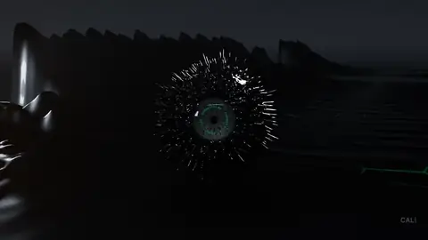
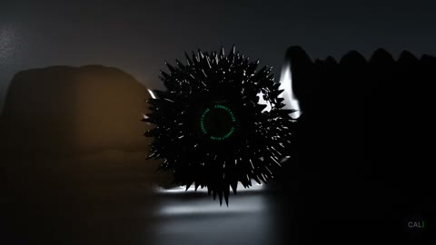

# 05 · 음악에 반응하는 루프



곡을 분석한 숫자로 페로플루이드 구의 스파이크와 눈동자, 협곡이 박자에 맞춰 움직이는 13.3초 무한 루프. 모든 움직임은 `CTRL` 엠프티의 값(`amp`, `kick`, `pupil`, `tape` 등)에 프레임마다 구워져 있어요. 원래 음악 파일은 들어 있지 않아요.

| 모델 | 난이도 | 엔진 | 원본 프롬프트 |
|---|---|---|---|
| `audio-reactive-loop.blend` · 6 MB | 중급 | Cycles | [prompt.txt](prompt.txt) |

## 받기 · 열기

```bash
python tools/get_scene.py audio-reactive-loop
```

## 실습 프롬프트

**쉬움**
```
CTRL 엠프티의 값들이 각각 무엇을 움직이는지 드라이버를 따라가서 표로 정리해줘.
```

**중간**
```
내 음악 파일 (경로/곡.wav)을 파이썬으로 분석해서(24fps, 저음 에너지 · 킥 · 하이햇) CTRL의 amp, kick 값을 새로 구워줘. 길이는 곡에 맞추고, 첫 프레임과 마지막 프레임이 이어지는지 수치로 알려줘.
```

**어려움**
```
드롭 구간에서만 카메라가 구 주위를 반 바퀴 도는 불릿타임을 추가해줘. 드롭 위치는 kick 값이 가장 크게 몰린 구간에서 찾아줘. 루프 이음새가 깨지지 않게.
```

## 결과 예시



## 내 것으로 만들기

내 곡으로 다시 구우면 완전히 다른 영상이 돼요. 음악은 직접 만들었거나 사용 허락을 받은 곡만 쓰세요.

## 스크립트 · scripts/

`scripts/iterations/`는 AI가 이 장면을 만들 때 Blender MCP의 `execute_blender_code`로 실제로 보낸 코드를 순서대로 모은 것이고, `scripts/`의 나머지 파일은 그 코드가 불러 쓴 빌드 스크립트예요. 원래 작업 폴더의 절대 경로는 상대 경로로 바꿔 두었어요. 처음부터 다시 만드는 참고용이라 그대로 실행하면 경로나 순서가 맞지 않을 수 있어요. 완성된 장면은 위의 모델 파일을 쓰세요.

---
English: a seamless 13.3 s loop driven by audio values baked on the `CTRL` empty (music not included). Practice: map the drivers, rebake with your own track, add a bullet-time drop. The `scripts/` folder holds the Blender Python the AI actually wrote for this scene (paths made relative; for reference).
